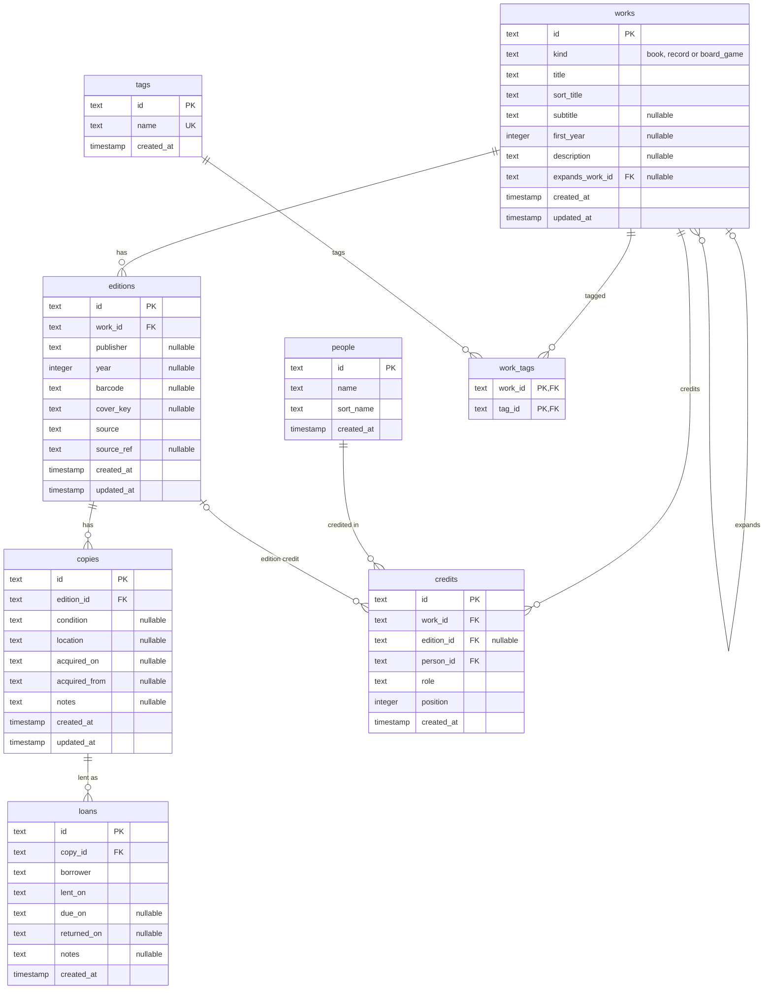
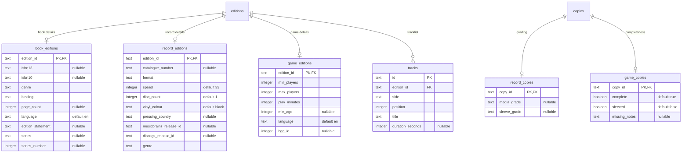
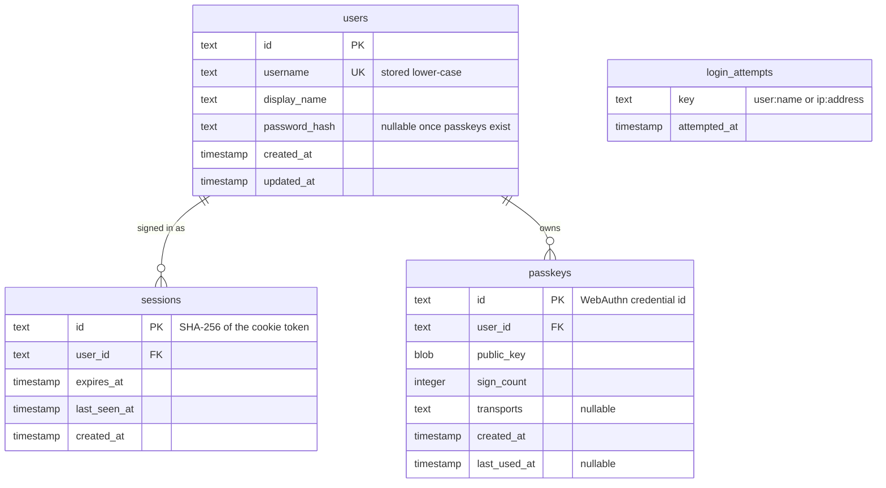

# Shelf: revival plan

Last updated 23 October 2026. Milestone 0 (Foundations) is complete and
deployed at <https://shelf.dank-shelf.workers.dev>. This version reflects the
repository as built (`Macavitymadcap/shelf` at `f876900`) and folds in what
milestone 0 taught: about 45 follow-up questions, grouped in
[Lessons from milestone 0](#lessons-from-milestone-0).

Shelf is a rebuild of [deno-books](https://github.com/Macavitymadcap/deno-books)
as a public catalogue of books, vinyl records and board games, running for
£0 on Cloudflare Workers with D1 and R2. Anyone can browse; one or two
signed-in users can add, edit, delete and lend.

## Status

| Milestone             | Delivers                                                                   | Gate                                                | Status                                                                                          |
| --------------------- | -------------------------------------------------------------------------- | --------------------------------------------------- | ----------------------------------------------------------------------------------------------- |
| 0 Foundations         | Monorepo, Worker on `workers.dev`, D1 and R2 via Pulumi, schema v1, CI     | CI deploys a page from `main`                       | Done, 23 Oct 2026                                                                               |
| 1 Auth                | Tidy-ups, PBKDF2 measurement, password sign-in, D1 sessions, CSP, user CLI | Sign in and out on the deployed Worker from a phone | In progress; see `docs/1-auth.md`, then `docs/1c-interface.md` for the card catalogue interface |
| 2 Catalogue           | Public pages, FTS5 search, manual add, edit and delete, htmx               | First 20 items entered by hand                      | Planned                                                                                         |
| 3 Lookup and scanning | Barcode classification, providers, candidate picker, scanner               | A photo of an ISBN fills the form                   | Planned                                                                                         |
| 4 Covers and loans    | Covers in R2, lending and returns, loans page                              | A copy lent and returned                            | Planned                                                                                         |
| 5 Passkeys and polish | Passkey enrolment and sign-in, BGG lookup                                  | Phone signs in with a passkey                       | Planned                                                                                         |

Auth comes before any edit form so nothing that writes data reaches
production unprotected. FTS5 search moved into milestone 2 alongside the
search page.

## Overview

The app keeps the hypermedia approach of the original: the server renders
HTML with Hono JSX, and htmx swaps fragments in place. The only substantial
client-side code is the barcode scanner, carried over from the
[barcode-detector](https://github.com/Macavitymadcap/barcode-detector)
experiment.

The first version covers:

- Three kinds of item: books (novels, graphic novels, poetry, non-fiction),
  vinyl records and board games.
- Multiple editions of a work and multiple copies of an edition.
- Adding items by manual entry, by searching a provider by title or barcode,
  or by photographing a barcode.
- Cover images copied into R2 rather than hotlinked.
- Loans: who has a copy, since when, and lending history.
- Self-built authentication for editing; no public sign-up.

## Decisions

Everything runs inside Cloudflare's free allowances; the only accounts
outside Cloudflare are free API tokens and Pulumi Cloud.

| Concern            | Choice                                                                                                                                                     | Why                                                                                                                              |
| ------------------ | ---------------------------------------------------------------------------------------------------------------------------------------------------------- | -------------------------------------------------------------------------------------------------------------------------------- |
| Toolchain          | Vite+ 1.4 (`vp`) with pnpm 12, `vite:monorepo` template                                                                                                    | One tool for dev, build, test (Vitest 5), lint (Oxlint), format (Oxfmt) and type-check (tsgo)                                    |
| Runtime            | Cloudflare Workers, `nodejs_compat`, `shelf.dank-shelf.workers.dev`                                                                                        | No sleep or cold-start penalty; Hono runs natively                                                                               |
| Web framework      | Hono 4.13 with Hono JSX                                                                                                                                    | Same pattern as the original; JSX templates, typed routes and middleware                                                         |
| Interactivity      | htmx 4.0 (`htmx.org@4`), from milestone 2                                                                                                                  | Hypermedia approach kept; no SPA                                                                                                 |
| Styling            | Open Props scales (sizes, fonts, borders, shadows, red, blue) in `apps/web/public/vendor/open-props/`, plus a small reset instead of Open Props' normalize | Consistent spacing and type for 2.4 KB gzipped; self-hosted so the CSP can stay `'self'`; normalize's opinions fought the design |
| Interface          | Card catalogue look; atomic components with one stylesheet each, in cascade layers                                                                         | Mobile first at 360 px (Galaxy A5); dark mode follows the phone; see Interface conventions                                       |
| Typefaces          | Libre Caslon Text for titles, Courier Prime for typed details, self-hosted woff2 from Fontsource                                                           | The phone only has Roboto and Noto Serif; about 115 KB for five files                                                            |
| Database           | Cloudflare D1 (SQLite)                                                                                                                                     | Free and bound directly to the Worker                                                                                            |
| ORM and migrations | Drizzle ORM 0.45 with drizzle-kit 0.31                                                                                                                     | Typed schema, generated SQL migrations, D1 driver                                                                                |
| Tests              | Vitest via `vp test`; D1 tests use Wrangler's `getPlatformProxy` and Drizzle's D1 migrator                                                                 | Real local D1 in Node tests; no Workers test pool needed                                                                         |
| Validation         | Valibot, from milestone 2                                                                                                                                  | Small bundle; parses form posts and provider responses                                                                           |
| Cover storage      | Cloudflare R2                                                                                                                                              | Free egress; images copied in at add time                                                                                        |
| Auth               | Self-built: password then passkeys; D1-backed sessions in a `__Host-` cookie                                                                               | A learning goal; replaces the deno-books JWT in `localStorage`                                                                   |
| Infrastructure     | Pulumi (TypeScript) for D1, R2 and secret values; Wrangler deploys the Worker                                                                              | Tries Pulumi without fighting it over bundling                                                                                   |
| CI                 | GitHub Actions with `setup-vp` and `pulumi/actions`                                                                                                        | Check, test and build on every push; deploy from `main`                                                                          |

### Free allowances that matter

| Service                                                               | Free allowance                                                                        | Pressure point                                                  |
| --------------------------------------------------------------------- | ------------------------------------------------------------------------------------- | --------------------------------------------------------------- |
| [Workers](https://developers.cloudflare.com/workers/platform/limits/) | 100,000 requests a day; 10 ms CPU per request; 50 subrequests per request             | Password hashing CPU; provider fan-out                          |
| [D1](https://developers.cloudflare.com/d1/platform/pricing/)          | 5 million rows read and 100,000 written a day; 5 GB                                   | None at catalogue scale                                         |
| [R2](https://developers.cloudflare.com/r2/pricing/)                   | 10 GB-month; 1 million Class A and 10 million Class B operations a month; free egress | Cover image sizes; R2 needed a payment method on file to enable |

## Monorepo layout

One deployable app, internal packages that are never built or published,
and the Pulumi program. Packages arrive with the milestone that needs them.

```
shelf/
├── apps/
│   └── web/            Hono Worker: routes, pages, scripts, wrangler.jsonc   (0)
├── packages/
│   ├── catalogue/      domain vocabulary: kinds, roles, formats, code checks (0)
│   ├── db/             Drizzle schema, migrations, client, test helper       (0)
│   ├── auth/           hashing, sessions, throttling, Hono middleware        (1)
│   ├── providers/      Open Library, Google Books, MusicBrainz, Discogs, BGG (3)
│   ├── covers/         fetch, check and store cover images in R2             (4)
│   ├── scanner/        browser BarcodeDetector module                        (3)
│   └── ui/             shared Hono JSX components, if apps/web outgrows them (2)
├── infra/              Pulumi program: D1, R2, secret values                 (0)
├── docs/               plan and milestone guides
├── vite.config.ts      root lint, format, staged and task settings
└── pnpm-workspace.yaml workspace packages, catalog, build approvals
```

| Package     | Depends on       | Runs in               | Notes                                                                                 |
| ----------- | ---------------- | --------------------- | ------------------------------------------------------------------------------------- |
| `catalogue` | nothing          | Worker and browser    | The shared vocabulary: kinds, roles, formats, grades, ISBN and EAN checks             |
| `db`        | `catalogue`      | Worker; tests in Node | `createDb(d1)` takes the binding; `@shelf/db/testing` gives tests a migrated local D1 |
| `auth`      | `db`             | Worker; CLI in Node   | Web Crypto only, so the same code hashes in the Worker, the tests and the user CLI    |
| `providers` | `catalogue`      | Worker                | Each adapter maps a provider response to one `Candidate` shape                        |
| `covers`    | nothing          | Worker                | Takes an `R2Bucket`; checks content type and size before storing                      |
| `scanner`   | nothing          | Browser               | Bundled by Vite into one small script for the add page                                |
| `web`       | all of the above | Worker                | Composition: middleware, routes and pages                                             |

### Package conventions

These are the settings milestone 0 had to discover one error at a time.

- Internal packages are `"private": true`, export TypeScript source directly
  (`"exports": { ".": "./src/index.ts" }`) and have no `build`, `pack` or
  `vite.config.ts`. After `vp create vite:library`, delete the template's
  `vite.config.ts`, sample test, `bumpp` and publishing fields.
- Imports between files use explicit `.ts` extensions, as the template's
  `allowImportingTsExtensions` setting expects.
- `vp add '@shelf/db@workspace:*'` (quoted, or zsh expands the `*`) records the dependency as `catalog:` and adds
  `'@shelf/db': workspace:*` to the catalog in `pnpm-workspace.yaml`, because
  the workspace uses `catalogMode: prefer`. That is expected and works.
- Every package takes `@types/node` and `typescript` from the catalog. Two
  `@types/node` versions make pnpm install two copies of Vite+, and package
  tests then fail before running with "Cannot read properties of undefined
  (reading 'config')".
- `infra` keeps the TypeScript 5 that `pulumi new` installed, because Pulumi
  compiles the program itself; moving it to TypeScript 7 is untested.
- A package gets a `"test": "vp test run"` script only once it has tests;
  `vp run -r test` fails on a package with none.
- New dependencies with install scripts must be approved in `allowBuilds` in
  `pnpm-workspace.yaml` (`vp pm approve-builds`). Approve what the tool
  needs (`esbuild`, `workerd`) and deny the rest (`protobufjs: false`).

### Code conventions

- Bindings (D1, R2, secrets) are passed into package functions, so packages
  stay testable outside the Worker.
- Source files stay under about 100 lines and functions around 10, split by
  concept.
- Strict TypeScript, Conventional Commits, and Arrange, Act and Assert
  comments in tests.
- Lint and format settings live once in the root `vite.config.ts`. The
  pre-commit hook runs `vp check --fix` on staged files, so it also
  reformats generated files such as `worker-configuration.d.ts`.

### Interface conventions

- Components live in `apps/web/src/components/{atoms,molecules,organisms,templates}`;
  pages in `src/pages` compose them. Each component has one stylesheet of
  the same name in the matching folder under `public/styles`, imported in
  `public/styles/app.css`, the only stylesheet the page links.
- Layers, in order: `vendor, reset, tokens, base, atoms, molecules,
  organisms, templates`. A later layer wins, so no specificity contests.
- Components use the semantic tokens in `tokens.css` (`--ink`, `--card`,
  `--desk`, `--rule-red`, `--rule-blue`, `--focus`, `--line`); Open Props
  supplies sizes, radii, shadows and the raw colours behind the tokens.
  Only the Open Props groups in use are vendored; a new group means a line
  in `scripts/vendor.ts` and an `@import` in `app.css`.
- `public/vendor` is copied, never edited, and excluded from formatting.
- No `style` attributes: the CSP blocks them.
- Each part of a component has a class prefixed with the component name
  (`.index-card__title`); variations use `data-` attributes. Parts are flat
  rules; `&` nesting is only for states, pseudo-elements, variants and media
  queries. Native nesting has no Sass-style `&__part`.
- A stylesheet selects only its own component's classes; a parent places a
  child by passing it a class, never with a descendant selector.
- Components take view shapes such as `ItemSummary`, never database rows.
- Every component appears on the signed-in component sheet,
  `/manage/styleguide`, with sample data.
- Tap targets are at least 44 px; text contrast clears WCAG AA in both
  schemes.

## Data model

Three levels separate what a thing is from what you own: a work
(_Watchmen_), its editions (the 2019 Absolute hardback) and your copies (the
one on the second shelf, lent to a friend). Kind-specific fields sit in one
detail table per kind, keyed by the edition or copy.

### Rules that apply to every table

- A column is required only when you can always fill it from the item in
  your hands. Providers are a shortcut, never the source of truth: every
  lookup lands in the edit form before saving, every field can be
  overridden, and nothing re-syncs later. Identifiers that older or
  independent items lack stay optional: `barcode`, `isbn13`, `isbn10`,
  `catalogue_number` and `pressing_country`.
- A manual entry saves with `source` set to `manual` and no `source_ref`.
- Ids are text UUIDs from `crypto.randomUUID()`, except `sessions.id` (the
  SHA-256 of the cookie token) and `passkeys.id` (the WebAuthn credential
  id), which the code supplies.
- Timestamps are integer milliseconds (`timestamp_ms`); calendar dates such
  as `lent_on` and `acquired_on` are ISO text.
- Language columns hold BCP 47 tags (`en`, `la`, `grc`); the page shows names
  through `Intl.DisplayNames`.

### Catalogue tables

Nullable columns are marked `nullable`; every other column is `NOT NULL`.



### Kind detail tables

Each detail table shares its parent's key, so an edition or copy has at most
one detail row of each kind.



Allowed values live in `catalogue` as typed lists:

- `book_editions.genre`: novel, graphic novel, poetry, short stories,
  non-fiction, anthology.
- `binding`: hardback, paperback, omnibus, absolute.
- `record_editions.genre`: Discogs' top-level genres (rock, electronic, pop,
  reggae, funk and soul, jazz, hip hop, folk, blues, classical, latin, stage
  and screen). Finer styles such as ska or 2 Tone go in tags.
- `format`: LP, 2LP, 12-inch single, 10-inch, 7-inch, box set; `speed`: 33,
  45 or 78.
- `media_grade` and `sleeve_grade`: Goldmine M, NM, VG+, VG, G+, G, F, P.
- `tracks.side` runs A, B, C and on across discs. A provider position such as
  `A1` splits into side A and position 1; a numbered-only tracklist defaults
  to side A in the form.

### Roles by kind

- Books: author, writer, artist, penciller, inker, colourist, letterer,
  illustrator, cover artist, translator, editor.
- Records: artist, featured artist, producer, engineer, composer, sleeve
  designer.
- Board games: designer, artist, developer.

### Auth tables



`login_attempts` has no foreign key on purpose: its key records attempts for
usernames that do not exist. Rows older than 15 minutes are deleted on each
sign-in.

### Delete rules

Rows that cannot exist without their parent cascade; anything that would
silently lose catalogue data restricts.

| Foreign key                             | References                   | On delete | Why                                                     |
| --------------------------------------- | ---------------------------- | --------- | ------------------------------------------------------- |
| `editions.work_id`                      | `works.id`                   | restrict  | A work with editions is not deleted by accident         |
| `copies.edition_id`                     | `editions.id`                | restrict  | An edition you own copies of is not deleted by accident |
| `loans.copy_id`                         | `copies.id`                  | cascade   | A loan means nothing once the copy is gone              |
| `credits.work_id`                       | `works.id`                   | cascade   | Credits belong to the work                              |
| `credits.edition_id`                    | `editions.id`                | cascade   | Edition-specific credits go with the edition            |
| `credits.person_id`                     | `people.id`                  | restrict  | Only uncredited people can be deleted                   |
| `work_tags.work_id`, `work_tags.tag_id` | `works.id`, `tags.id`        | cascade   | Links go with either side                               |
| `works.expands_work_id`                 | `works.id`                   | set null  | Expansions stay when their base game goes               |
| Kind detail tables, `tracks`            | `editions.id` or `copies.id` | cascade   | Details are part of their parent                        |
| `sessions.user_id`, `passkeys.user_id`  | `users.id`                   | cascade   | Removing a user signs them out everywhere               |

Deleting a whole work therefore runs copies, then editions, then the work,
as one `db.batch()`, which D1 runs as a single transaction.

### Indexes

| Table                  | Columns                                                      | Type            | Serves                             |
| ---------------------- | ------------------------------------------------------------ | --------------- | ---------------------------------- |
| `works`                | `kind, sort_title`                                           | index           | Browse pages by kind, A to Z       |
| `works`                | `expands_work_id`                                            | index           | A game's expansions                |
| `editions`             | `work_id`                                                    | index           | Work page; restrict check          |
| `editions`             | `barcode`                                                    | index           | "Already own this?" after a scan   |
| `book_editions`        | `isbn13`; `isbn10`                                           | index each      | The same check for books           |
| `copies`               | `edition_id`                                                 | index           | Copy counts; restrict check        |
| `loans`                | `copy_id`                                                    | index           | Lending history                    |
| `loans`                | `copy_id` where `returned_on is null`                        | unique, partial | One open loan per copy             |
| `tracks`               | `edition_id, side, position`                                 | unique          | No duplicate tracks; running order |
| `people`               | `sort_name`                                                  | index           | People A to Z                      |
| `credits`              | `work_id`; `person_id`; `edition_id`                         | index each      | Work, person and edition credits   |
| `credits`              | `work_id, person_id, role` where `edition_id is null`        | unique, partial | No duplicate work credits          |
| `credits`              | `edition_id, person_id, role` where `edition_id is not null` | unique, partial | No duplicate edition credits       |
| `work_tags`            | `tag_id`                                                     | index           | Works with a tag                   |
| `tags`                 | `name`                                                       | unique          | One tag per name                   |
| `users`                | `username`                                                   | unique          | Sign-in lookup                     |
| `sessions`, `passkeys` | `user_id`                                                    | index each      | Per-user lookups and cascades      |
| `login_attempts`       | `key, attempted_at`                                          | index           | The throttle check                 |

Barcodes, ISBNs and people's names stay non-unique: labels reuse barcodes
across represses, publishers occasionally reuse ISBNs, and two authors can
share a name. The app warns about a match rather than refusing it.

### Search

An FTS5 virtual table, `search`, holds one row per work: title and subtitle,
people's names and tags. drizzle-kit cannot model virtual tables, so it is a
hand-written migration (`drizzle-kit generate --custom --name=search`) added
in milestone 2.

```sql
CREATE VIRTUAL TABLE search USING fts5(
  work_id UNINDEXED,
  title,
  people,
  tags,
  tokenize = 'unicode61 remove_diacritics 2',
  prefix = '2 3'
);
```

- `reindexWork(db, workId)` in `db` rebuilds one work's row inside the same
  `db.batch()` as every save that touches the work; there are no triggers.
- Queries run as raw SQL (`where search match ? order by rank`) after the
  input is turned into quoted terms with a trailing `*`.
- `wrangler d1 export` refuses databases with virtual tables. Backups rely on
  D1 Time Travel (7 days on the free plan), or an export script that drops
  `search`, exports and rebuilds it.

## Data providers and lookup

A barcode decides the provider: an ISBN goes to the book sources, any other
EAN or UPC goes to the record sources, and board games are found by name.

| Provider                                                                 | Kind        | Lookup                              | Key                                                         | Limits and terms                        |
| ------------------------------------------------------------------------ | ----------- | ----------------------------------- | ----------------------------------------------------------- | --------------------------------------- |
| [Open Library](https://openlibrary.org/developers/api)                   | Books       | ISBN, title                         | None                                                        | Covers at `covers.openlibrary.org`      |
| [Google Books](https://developers.google.com/books/docs/v1/using)        | Books       | `q=isbn:…`, title                   | Free API key                                                | Fallback for Open Library               |
| [MusicBrainz](https://musicbrainz.org/doc/MusicBrainz_API/Rate_Limiting) | Records     | Barcode, title and artist           | None; contact User-Agent required                           | About 1 request a second per IP         |
| [Discogs](https://www.discogs.com/developers)                            | Records     | `barcode=`, catalogue number, title | Free personal token                                         | 60 requests a minute; images need auth  |
| [BoardGameGeek](https://boardgamegeek.com/using_the_xml_api)             | Board games | Name only                           | Free registered-app token; approval can take a week or more | Public pages must show "Powered by BGG" |

Comic Vine is out: its API needs a key. Graphic novels come through the ISBN
sources.

### Lookup flow

1. The add page takes a typed barcode, a photo of one, or a title search with
   a kind chosen.
2. `catalogue.classifyCode` normalises the digits and checks the check digit.
   978 or 979 EAN-13 codes and ISBN-10s are books; other EAN-13 and UPC-A
   codes are records.
3. `providers` queries the matching sources in parallel, each with a short
   timeout, and maps every hit to one `Candidate` shape.
4. The page shows candidates side by side, plus "enter it myself" pre-filled
   with the barcode.
5. Choosing a candidate opens the edit form pre-filled; nothing is saved until
   you submit.
6. On save, the server finds or creates the work and people, creates the
   edition and its first copy, then `covers` copies the image into R2.
7. If the edition already exists, the page offers "add another copy".

### Scanning

Chrome on Android ships the native `BarcodeDetector`, so the scanner needs
no WASM fallback. An `<input type="file" accept="image/*"
capture="environment">` opens the camera, the photo is decoded with
`createImageBitmap`, and the first EAN-13, EAN-8, UPC-A or UPC-E result
fills the barcode field and triggers the lookup.

### Covers

`covers` fetches the image server-side, accepts JPEG, PNG and WebP up to
2 MB, stores it as `covers/<edition id>.<ext>`, and the app serves it from
`/covers/:key` with long cache headers.

## Authentication

Milestone 1 builds password sign-in; milestone 5 adds passkeys. Reading
stays public. Every `POST`, `PUT`, `PATCH` and `DELETE` passes Hono's
`csrf()` check, and everything under `/manage` passes `requireUser`. There is
no public sign-up: users are created with a CLI script.

### What changes from deno-books

| deno-books did                                                                        | Problem                                     | Shelf does                                                                                                |
| ------------------------------------------------------------------------------------- | ------------------------------------------- | --------------------------------------------------------------------------------------------------------- |
| Wrote the token into the page with an inline `<script>` and kept it in `localStorage` | Any script on the page can read and send it | `__Host-session` cookie: `HttpOnly`, `Secure`, `SameSite=Lax`, `Path=/`                                   |
| Signed JWTs with a key generated in memory at start-up                                | Every restart logged everyone out           | A 32-byte random token; only its SHA-256 is stored in `sessions`                                          |
| Logout cleared `localStorage` only                                                    | The JWT stayed valid until expiry           | Logout deletes the session row                                                                            |
| Open `/register` endpoint                                                             | Anyone could create an editor account       | `apps/web/scripts/create-user.ts`, run locally or against remote D1                                       |
| bcrypt with a second, hand-appended salt                                              | Redundant; bcrypt is not in Web Crypto      | PBKDF2-SHA-256 via `crypto.subtle`, 16-byte salt, HMAC pepper from a Worker secret, versioned hash string |
| Returned raw error JSON                                                               | Leaked internals                            | Fixed messages; details in Workers logs                                                                   |

### Sign-in flow

1. `GET /login` renders the form; `POST /login` takes username and password.
2. Failures are recorded under `user:<username>` and `ip:<address>`; five in
   15 minutes on either key returns 429 until they age out.
3. The password is peppered with HMAC-SHA-256, derived with PBKDF2 and
   compared in constant time. Unknown usernames still run one derivation
   against a dummy hash, so timing does not reveal which accounts exist.
4. Success creates the session row, sets the cookie and redirects with 303 to
   a same-site `next` path.
5. `loadUser` reads the cookie on every request. When the session was last
   seen over a day ago it extends `expires_at` by 30 days, so sessions end
   after 30 days idle and D1 sees at most one write a day per session.
6. `requireUser` redirects signed-out page requests to
   `/login?next=…`; htmx requests get 401 with `HX-Redirect`.

### Headers

- `secureHeaders()` sends a Content Security Policy of `default-src 'self'`
  with a per-request script nonce, plus Hono's default hardening headers.
  Stylesheets are self-hosted for this reason.
- From milestone 2, htmx's `hx-csp` extension strips htmx attributes from any
  element without the page's nonce, so injected markup cannot fire requests.
- Templates rely on Hono JSX escaping; no `raw()` on stored or provider data.

### The CPU budget

The Workers free plan allows 10 ms of CPU per request, and Cloudflare's
production runtime reportedly rejects PBKDF2 counts above 100,000. The local
runtime enforces neither, so milestone 1 measures on the deployed Worker
before choosing `ITERATIONS`. If 100,000 does not fit, the count drops to
the largest that does, which stays sound here because of the secret pepper
and 16-character minimum, generated passwords; passkeys then become the main
sign-in in milestone 5.

## Infrastructure, secrets and CI

Pulumi owns the long-lived resources and the secret values; Wrangler builds
and deploys the Worker.

| Resource                             | Managed by              | Notes                                                               |
| ------------------------------------ | ----------------------- | ------------------------------------------------------------------- |
| D1 database `shelf`                  | Pulumi, `protect: true` | Id synced into `wrangler.jsonc` by `infra/scripts/sync-wrangler.ts` |
| R2 bucket `shelf-covers`             | Pulumi                  | R2 had to be enabled once in the dashboard first                    |
| `workers.dev` subdomain `dank-shelf` | Dashboard, once         | Account-wide; registered on the first interactive deploy            |
| Worker `shelf` and its secrets       | Wrangler                | Secrets persist across deploys                                      |

### Secrets

The encrypted Pulumi stack config (`infra/Pulumi.prod.yaml`) is the one
place secret values live; `pulumi config get <key>` recovers any of them.
Worker secrets are set once from it with `wrangler secret put` and survive
every deploy, so CI never pushes secrets.

| Stack config key                             | Used by                         | Arrives in |
| -------------------------------------------- | ------------------------------- | ---------- |
| `cloudflare:apiToken`                        | Pulumi's Cloudflare provider    | 0          |
| `passwordPepper`                             | Worker secret `PASSWORD_PEPPER` | 1          |
| `googleBooksKey`, `discogsToken`, `bggToken` | Worker secrets                  | 3 and 5    |

Local development uses a different pepper in `apps/web/.dev.vars`
(git-ignored); `vp run cf-typegen` reads it to add the secret's name to
`Env`.

### Cloudflare API token

One custom token serves Pulumi and CI, scoped to the one account:

| Permission                  | Level | Needed by                 |
| --------------------------- | ----- | ------------------------- |
| Account, D1                 | Edit  | Pulumi; remote migrations |
| Account, Workers R2 Storage | Edit  | Pulumi                    |
| Account, Workers Scripts    | Edit  | `wrangler deploy`         |
| Account, Account Settings   | Read  | `wrangler deploy`         |
| User, Memberships           | Read  | Wrangler's account lookup |
| User, User Details          | Read  | Wrangler's account lookup |

### CI on GitHub Actions

| Job      | Runs on                       | Steps                                                                                                    |
| -------- | ----------------------------- | -------------------------------------------------------------------------------------------------------- |
| `check`  | Every push and pull request   | `vp install`, `vp check`, `vp run -r test`, `vp -C apps/web build`                                       |
| `deploy` | Push to `main`, after `check` | `pulumi up`, `sync-wrangler.ts`, `wrangler d1 migrations apply DB --remote`, `vp -C apps/web run deploy` |

Repository secrets: `CLOUDFLARE_API_TOKEN`, `CLOUDFLARE_ACCOUNT_ID` and
`PULUMI_ACCESS_TOKEN`.

## Local development

| Task                       | Command (from the repo root unless stated)                         |
| -------------------------- | ------------------------------------------------------------------ |
| Run the app                | `vp run dev`, then <http://localhost:5173>                         |
| Check everything CI checks | `vp run ready`                                                     |
| Generate a migration       | `vp -C packages/db run db:generate`                                |
| Apply migrations locally   | `vp -C apps/web run migrate --local`                               |
| Regenerate `Env` types     | `vp -C apps/web run cf-typegen`                                    |
| Create a user              | `cd apps/web && vp exec vpx ./scripts/create-user.ts --local`      |
| Query local D1             | `vp -C apps/web exec wrangler d1 execute DB --local --command "…"` |

Notes from milestone 0:

- On a machine whose VPN inspects HTTPS, Node rejects the VPN's certificate.
  `export NODE_OPTIONS=--use-system-ca` in `~/.zshrc` makes Node trust the
  macOS keychain. The same VPN blocks `*.workers.dev`, so check deployments
  from a phone on mobile data.
- `vp run` is not interactive. Commands that prompt, such as a first
  `wrangler deploy`, need `vp exec` or a direct terminal.
- `compatibility_date` must not be newer than the installed `workerd`
  version shown in its package path.
- Tests that touch D1 use `createTestDb()` from `@shelf/db/testing`, which
  starts an in-memory local D1 through Wrangler and applies the migrations.
  Each test file takes two to three seconds to start.

## Routes and htmx

Every route returns HTML. The table lists the full app; milestone 1 builds
`/`, `/login`, `/logout` and a placeholder `/manage`.

| Method    | Path                          | Auth      | Returns                                                    |
| --------- | ----------------------------- | --------- | ---------------------------------------------------------- |
| GET       | `/`                           | Public    | Recently added, counts by kind, search box                 |
| GET       | `/search?q=&kind=`            | Public    | Result list, swapped as you type                           |
| GET       | `/works/:id`                  | Public    | Work, editions and copies; loan status only when signed in |
| GET       | `/people/:id`                 | Public    | Everything credited to a person, by role                   |
| GET       | `/covers/:key`                | Public    | Image from R2 with long cache headers                      |
| GET, POST | `/login`                      | Public    | Form; session cookie and redirect                          |
| POST      | `/logout`                     | Signed in | Session deleted, cookie cleared                            |
| GET       | `/manage`                     | Signed in | Management home                                            |
| GET       | `/manage/add`                 | Signed in | Barcode field, camera button, title search, manual entry   |
| POST      | `/manage/lookup`              | Signed in | Candidate list fragment                                    |
| POST      | `/manage/works`               | Signed in | Creates work, edition and copy                             |
| GET, PUT  | `/manage/works/:id/edit`      | Signed in | Edit form; saved row fragment                              |
| POST      | `/manage/editions/:id/copies` | Signed in | New copy row fragment                                      |
| DELETE    | `/manage/copies/:id`          | Signed in | Empty response after `hx-confirm`                          |
| POST      | `/manage/copies/:id/loans`    | Signed in | Loan badge fragment                                        |
| PATCH     | `/manage/loans/:id/return`    | Signed in | Badge cleared to available                                 |
| GET       | `/manage/loans`               | Signed in | Everything currently out, oldest first                     |

### htmx 4 patterns

- Install `htmx.org@4`; npm `latest` stays on htmx 2 until early 2027. How
  the script reaches the page (copied into `public/vendor/` like Open Props,
  or bundled by a Vite client entry with the scanner) is decided in
  milestone 2; either way it loads from the app's own origin with the nonce.
- One `render(c, page, fragment)` helper reads `HX-Request-Type`: `full` gets
  the layout, `partial` gets the fragment.
- Inheritance is explicit: `hx-boost:inherited="true"` on the manage layout's
  `<main>`; `hx-confirm` on each delete button.
- 4xx and 5xx responses swap by default. A failed save returns 422 with the
  form fragment and `hx-swap="outerMorph"` keeps focus and typed input.
- `<hx-partial>` covers multi-target updates, such as a lent copy's row and
  the header's on-loan count.
- Forms keep a native `action` and `method`, so they work without JavaScript.
- Events use the `htmx:phase:action` names, such as `htmx:after:swap`.
- Extensions: `hx-csp` and `hx-preload`.

## Lessons from milestone 0

Milestone 0's guide gave the right steps but left about 45 questions to the
build. They fell into five groups, and the milestone 1 guide answers each
up front.

| Group                    | Questions | Examples                                                                                                       | What guides now do                                                              |
| ------------------------ | --------- | -------------------------------------------------------------------------------------------------------------- | ------------------------------------------------------------------------------- |
| Code shown in part       | ~12       | `layout.tsx`, the timestamps helper, composite and partial indexes, the schema barrel, configs                 | Give every new or changed file in full, at its path                             |
| Toolchain surprises      | ~10       | build approvals, compatibility date, duplicate DOM types, `workspace:` versions, `infra` outside the workspace | Name the error you may see and its fix at the step that triggers it             |
| Accounts and credentials | ~9        | Cloudflare account id, wrong login, Pulumi token, R2 enablement, token permissions, lost token                 | List every credential, where it lives and how to recover it before it is needed |
| Data model decisions     | ~10       | nullability, delete rules, kind ids, languages, track sides                                                    | Settle decisions in this plan before the guide uses them                        |
| Checking results         | ~5        | migration reviews, `git status`, blank page behind the VPN                                                     | State the expected output after each step and end each part with a checkpoint   |

## Open questions and risks

| Item                                    | Risk                                                                  | Fallback                                                 | Settled in |
| --------------------------------------- | --------------------------------------------------------------------- | -------------------------------------------------------- | ---------- |
| PBKDF2 against the 10 ms CPU limit      | 100,000 iterations may exceed it                                      | Largest count that passes; passkeys first in milestone 5 | 1          |
| Username lockout                        | Anyone can lock a known username for 15 minutes by failing five times | Accept for two users; passkeys bypass it later           | 1          |
| MusicBrainz's 1 request a second per IP | Workers share egress IPs, so lookups may get 503s                     | Retry once; Discogs answers alongside                    | 3          |
| BGG token approval                      | A week or more before game lookups work                               | Manual entry until then; apply now if not done           | 3          |
| FTS5 on remote D1                       | Virtual tables to confirm; exports refuse them                        | `LIKE` queries                                           | 2          |
| htmx delivery                           | Vendored file or Vite client entry                                    | Vendored file                                            | 2          |
| Pulumi state                            | Individual tier terms                                                 | Self-managed backend in R2                               | Open       |

Settled in milestone 0: the Cloudflare Vite plugin works under `vp dev` and
`vp build`; D1 tests run through `getPlatformProxy` instead of the Workers
test pool; R2 is enabled; the app is named `shelf`.

## Sources

- [Cloudflare Workers limits](https://developers.cloudflare.com/workers/platform/limits/)
- [D1 pricing](https://developers.cloudflare.com/d1/platform/pricing/)
- [R2 pricing](https://developers.cloudflare.com/r2/pricing/)
- [Hashing passwords on Cloudflare Workers](https://lord.technology/2024/02/21/hashing-passwords-on-cloudflare-workers.html)
  (the 100,000-iteration cap)
- [Native email and password authentication on Cloudflare Workers](https://flaviocopes.com/native-email-password-authentication-cloudflare-workers/)
- [htmx 4.0 release notes](https://four.htmx.org/announcements/2026-08-28-htmx-4.0.0-is-released)
- [Vite+ monorepo guide](https://viteplus.dev/guide/monorepo)
- [Pulumi Cloudflare provider](https://www.pulumi.com/registry/packages/cloudflare/)
